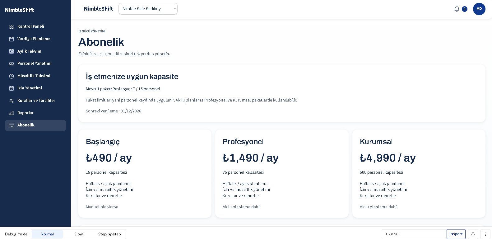

# NimbleShift – Ekran Görüntüleri

Bu klasör, NimbleShift uygulamasının mevcut arayüzünü ve temel özelliklerini gösteren ekran görüntülerini içerir.

## Kontrol Paneli

Uygulamanın genel görünümünü ve temel yönetim alanlarını gösterir.

## Personel Yönetimi

Personel kayıtlarının yönetildiği ekranı gösterir.

## Vardiya Planlama

Vardiya oluşturma ve planlama arayüzünü gösterir.

## Aylık Vardiya Takvimi

Vardiyaların aylık takvim görünümünü gösterir.

## Müsaitlik Takvimi

Personel müsaitlik bilgilerinin görüntülendiği ekranı gösterir.

## İzin Yönetimi

Personel izin taleplerinin yönetildiği ekranı gösterir.

## Kurallar ve Tercihler

Vardiya planlamasında kullanılan kural ve tercihlerin yönetildiği ekranı gösterir.

## Raporlar ve Fazla Mesai

Raporlama ve fazla mesai bilgilerinin görüntülendiği ekranı gösterir.

## Abonelik

Abonelik paketi bilgilerinin görüntülendiği ekranı gösterir.

## Not

Ekran görüntüleri uygulamanın geliştirme aşamasındaki mevcut arayüzünü temsil eder. Arayüz ve özellikler geliştirme sürecinde değişebilir.
